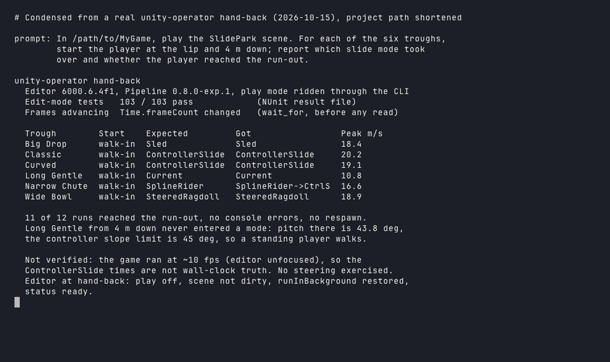

# gamedev-tooling

<p align="center"><strong>Claude Code agents, skills and environment setup for game development with Unity and Blender.</strong></p>

<p align="center">
  <a href="LICENSE"></a>
</p>

<p align="center"></p>

gamedev-tooling is a plugin for [Claude Code](https://code.claude.com). It adds an agent that changes and verifies a Unity project through a running editor, the operating discipline that keeps an agent-driven editor from stalling, a skill for Blender props that import into Unity at rotation 0, scale 1, a skill that draws the concept art those props are built from, and a setup guide for the whole toolchain. It is for anyone who builds a game with Claude Code and wants the agent to work inside the real editor, with measured results, instead of guessing from source files.

## Install

Needs [Claude Code](https://code.claude.com) with plugins. The Unity agent also needs the Unity CLI, a Unity 6 editor (last run against 6000.6.4f1), and Unity's `com.unity.pipeline` package in each project it drives; those are five more commands, listed in order in [docs/setup.md](docs/setup.md), which also covers Blender. One command adds the marketplace and installs the plugin:

```
claude plugin install gamedev-tooling --marketplace federbenjamin/gamedev-tooling
```

## Features

- **`unity-operator` agent.** Edits scripts, scenes, prefabs and settings, recompiles, runs the test suites, and rides play mode, all through the Unity CLI against a running editor of a project that has the Pipeline package. It reports measured numbers with their source and leaves the editor as it found it.
- **`unity-editor-ops` skill.** The discipline around the Unity CLI: reaching the right editor, changing through the editor's own commands, the play-mode loop that proves frames advance before a number is trusted, tests with the result file as the truth, the two warm worktree slots that keep an agent's branch and editor out of the checkout the person is playing in, and the failure modes that stall an agent-driven editor.
- **`blender-to-unity-props` skill.** Models props in Blender, by script or through a Blender MCP bridge, and exports FBX files that land in Unity at rotation 0, scale 1, true size, front toward +Z, with a notes file the importing agent reads.
- **`prop-concept-art` skill.** Generates concept art for a prop or character with Codex's image generation or Gemini's Nano Banana, held to the project's art style through an approved anchor image, one change per round, and hands the approved image to the Blender modeller.

## Usage

Ask Claude Code, in plain words, to hand a Unity task to the `unity-operator` agent, from a session whose working directory is the Unity project or with the project's absolute path in the prompt. Claude makes the call below; the agent targets that editor by path and opens it when it is not running:

```
Agent subagent_type=gamedev-tooling:unity-operator
  prompt: "In /path/to/MyGame, enter play mode on the Level1 scene, hold forward for
           5 s, and report the player's peak speed and whether a console error appeared."
```

It answers in under 40 lines: what changed, what the editor showed, what failed, and the editor's state at hand-back. The skills load on their own when a task matches their description; `/gamedev-tooling:blender-to-unity-props` runs the Blender skill by hand. Each agent's and skill's full instructions are its file under `agents/` or `skills/`.

## How it works

The agent never drives Unity through hand-edited scene files or a chat relay. It calls the `unity` command line tool, which finds the editor that has the project open and talks to `com.unity.pipeline`, Unity's package that gives a running editor a command surface (added once per project, see the setup doc): about 160 commands for scenes, assets, play mode, tests, recompiles, screenshots and arbitrary C#, with JSON results, detached jobs for long work, and a wait on the frame counter that proves a play-mode run is really advancing. Blender work runs headless by default, so a modelling script re-runs after any fix; an MCP bridge is the route when the agent owns a Blender window.

## Contributing

Report a problem in [issues](https://github.com/federbenjamin/gamedev-tooling/issues). PRs are welcome; see [CONTRIBUTING](https://github.com/federbenjamin/.github/blob/main/CONTRIBUTING.md) and [SECURITY](https://github.com/federbenjamin/.github/blob/main/SECURITY.md). There is no test suite: a change to an agent or skill is checked by running it against a real project and editor.

## License

MIT © Benjamin Feder
